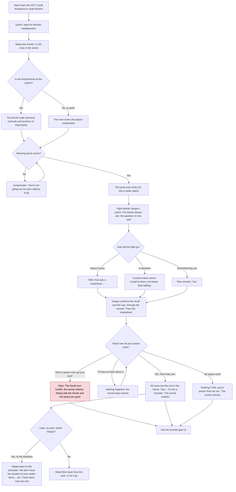
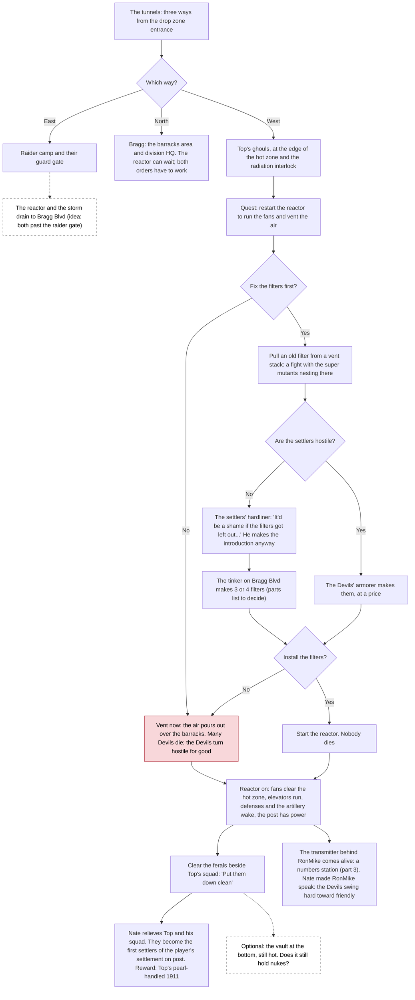
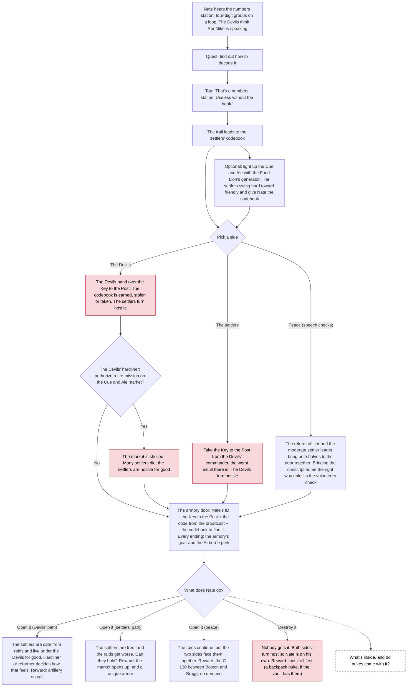

# Decision tree

The player's choices in The Devils in the Details, drawn from [DESIGN.md](DESIGN.md). Red boxes are
the ones that turn a faction hostile for good; dashed boxes are still undecided.

## 1. Boston to the drop zone

## 2. The tunnels and the reactor

## 3. The choice and the endings

## Still undecided

- What's in the armory, and whether the vault still holds nukes.
- Where the reactor and the storm drain sit (leaning: east, past the raider gate).
- What the tinker needs for the filters.
